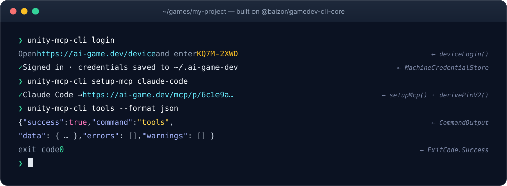

<div align="center">

<p></p>

[](https://www.npmjs.com/package/@baizor/gamedev-cli-core) [](https://github.com/IvanMurzak/AI-Game-Dev-CLI-Core/actions/workflows/ci.yml) [](https://nodejs.org/) [](package.json) [](LICENSE) [](https://stand-with-ukraine.pp.ua)

</div>

**`@baizor/gamedev-cli-core`** is the shared engine of the AI Game Dev command-line tools. It handles
sign-in, credentials, project identity, AI-agent setup, editor sessions and the CLI's output
contract. Each engine CLI is a thin adapter on top of it, so all of them behave the same way.

<p align="center">
  
</p>

## What it does

✅ **Sign-in** — OAuth 2.1 device code in terminals, browser login (PKCE) in the desktop App<br>
✅ **Credentials** — one store in `~/.ai-game-dev/`: DPAPI on Windows, `0600` on macOS/Linux<br>
✅ **Safe refresh** — tokens refresh under a lock shared by every process<br>
✅ **Project identity** — a stable pin and port per project, byte-for-byte equal to the C# plugin's<br>
✅ **AI agent setup** — `setup-mcp` writes MCP configs for Claude Code, Cursor, Codex and more<br>
✅ **Editor sessions** — reuse a running editor or start one headless; close only the ones it started<br>
✅ **Server download** — fetches the MCP server and checks its SHA-256 before running it<br>
✅ **CLI contract** — shared exit codes, `--format text|json|ndjson`, one JSON result envelope<br>
✅ **Update check** — looks for a newer CLI version on npm, cached for a day<br>
✅ **RQL routing** — splits RQL text into statements and picks `rql-query` or `rql-mutate`<br>
✅ **`EngineAdapter`** — the only place where Unity, Unreal and Godot differ

## See it in action

Every engine CLI gets the same sign-in, setup and output behaviour from this package:

<p align="center">
  
</p>

## Install

```bash
npm install @baizor/gamedev-cli-core
```

Requires Node.js **22.14** or newer. ESM only, with TypeScript declarations included.

## Usage

**Identify a project.** The same path always gives the same pin and port, in TypeScript and in C#.

```ts
import { derivePinV2, derivePortV2 } from "@baizor/gamedev-cli-core";

const pin = derivePinV2("/work/my-game");   // routes MCP traffic to this project
const port = derivePortV2("/work/my-game"); // local server port, 20000–29999
```

**Connect an AI agent.** One call writes the agent's MCP config, pinned to the project.

```ts
import { setupMcp, unityAdapter } from "@baizor/gamedev-cli-core";

const result = await setupMcp({
  adapter: unityAdapter,       // or unrealAdapter / godotAdapter
  agentId: "claude-code",
  projectPath: "/work/my-game",
});
if (result.kind === "success") console.log(`Configured: ${result.configPath}`);
```

**Get an access token.** The provider refreshes it when needed, under a lock shared by all processes.

```ts
import {
  HttpTokenRefresher,
  MachineCredentialProvider,
  MachineCredentialStore,
  unityAdapter,
} from "@baizor/gamedev-cli-core";

const credentials = new MachineCredentialProvider(
  new MachineCredentialStore(), // ~/.ai-game-dev/credentials.json
  new HttpTokenRefresher({ defaultServerBaseUrl: "https://ai-game.dev" }),
  { defaultClientId: unityAdapter.clientId },
);
const token = await credentials.getAccessToken(); // throws LoginRequiredError when signed out
```

**Answer like every other CLI.** One result envelope and one set of exit codes.

```ts
import { CommandOutput, ExitCode, parseFormat } from "@baizor/gamedev-cli-core";

const output = new CommandOutput("tools", parseFormat("json"));
output.finish(ExitCode.Success, { tools: ["scene-list"] });
// stdout, pretty-printed:
// { "success": true, "command": "tools", "data": { "tools": ["scene-list"] },
//   "errors": [], "warnings": [] }
```

## Exit codes

Scripts and AI agents can rely on these in every engine CLI:

| Exit | Meaning | Error codes |
|:---:|---|---|
| `0` | Success | |
| `1` | Unexpected error | `ERROR` |
| `2` | Bad command line or tool arguments, unknown tool or project | `USAGE`, `NOT_FOUND` |
| `6` | The command ran and failed, or there is no usable sign-in | `TOOL_FAILED`, `COMPILATION_FAILED`, `NOT_AUTHENTICATED` |
| `7` | The server or the engine plugin cannot be reached | `UNREACHABLE` |
| `8` | Tests failed | |
| `14` | Timed out | `TIMEOUT` |
| `17` | Busy: try again later, nothing ran | `BUSY` |
| `18` | A modal dialog blocks the editor: a human must answer it | `AWAITING_INPUT` |

The full table, with HTTP statuses, is `TOOL_FAILURE_CODES` and `EXIT_CODES` in
[`src/cli-contract.ts`](src/cli-contract.ts).

## Develop

```bash
npm install
npm run typecheck   # tsc --noEmit
npm run build       # dist/: ESM + .d.ts
npm test            # vitest
```

Releases are published to npm from the `release.yml` workflow with Trusted Publishing (OIDC).
Changes are listed in the [changelog](CHANGELOG.md).

## License

[MIT](LICENSE) © Ivan Murzak
